# Lab 2 : Prise en main et utilisation de Jenkins (CI/CD)

## Objectif

Construire un pipeline CI/CD fonctionnel avec Jenkins qui :

1. clone le projet depuis GitHub ;
2. compile l'application Spring Boot avec Maven ;
3. construit une image Docker ;
4. déploie l'application dans un conteneur.

## Remarque préalable

> **Java et Jenkins ont déjà été installés et configurés lors d'un autre lab.** Les étapes d'installation (Java, Jenkins en service, déverrouillage et configuration initiale) ne sont donc pas refaites dans ce compte rendu. Celui-ci commence directement à la **préparation du projet**.

## Environnement

| Élément | Valeur |
|---|---|
| Système | VM Ubuntu Server |
| Java | OpenJDK 21 (déjà installé) |
| Jenkins | Déjà installé en service systemd, port 8080 |
| Docker | Installé sur la même VM |
| Application | Spring Boot, port 2222 |

---

## 1. Préparation du projet

Fork du dépôt `wahid007/Jenkins-Demo` vers mon compte GitHub.


Modification du contenu de la page HTML (`src/main/resources/static/index.html`) :

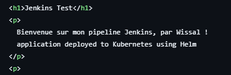

---

## 2. Configuration de Jenkins

### 2.1 Plugins installés

Plugins nécessaires : **Maven Integration**, **Docker**, **Docker Pipeline** (et Kubernetes CLI, non utilisé dans ce TP).


### 2.2 Configuration globale des outils

**JDK** (`JAVA_HOME = /usr/lib/jvm/java-21-openjdk-amd64`) :

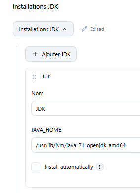

**Maven** (`maven-3.5.2`, installation automatique depuis Apache) :

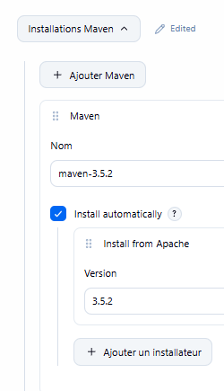

**Docker** (`MyDocker`) :

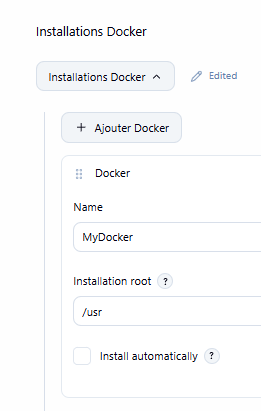

### 2.3 Accès de Jenkins à Docker

Jenkins et Docker étant sur la même VM, l'utilisateur `jenkins` a été ajouté au groupe `docker` :

```bash
sudo usermod -aG docker jenkins
sudo systemctl restart jenkins
sudo -u jenkins docker ps
```

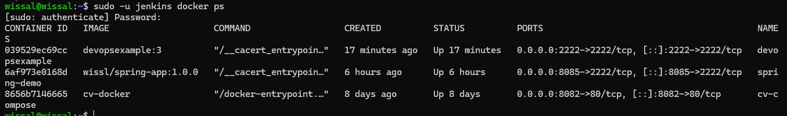

---

## 3. Création du pipeline

Création d'un item de type **Pipeline** nommé `Jenkins_test`. Il apparaît sur le tableau de bord avec son build #3 réussi :


Onglet *Général* : option **GitHub project** avec l'URL du fork :

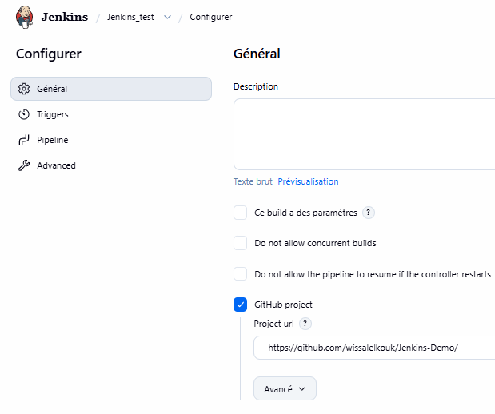

Section *Pipeline* : **Pipeline script from SCM**, SCM **Git**, branche `*/main` :

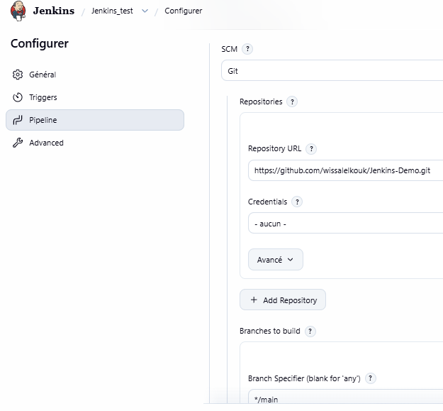

---

## 4. Fichiers du projet

### Jenkinsfile

```groovy
node {
    def mvnHome = tool 'maven-3.5.2'
    def dockerImageTag = "devopsexample:${env.BUILD_NUMBER}"

    stage('Clone Repo') {
        git branch: 'main', url: 'https://github.com/wissalelkouk/Jenkins-Demo.git'
    }

    stage('Build Project') {
        sh "${mvnHome}/bin/mvn clean package"
    }

    stage('Initialize Docker') {
        def dockerHome = tool 'MyDocker'
        env.PATH = "${dockerHome}/bin:${env.PATH}"
    }

    stage('Build Docker Image') {
        sh "docker build -t ${dockerImageTag} ."
    }

    stage('Deploy Docker Image') {
        echo "Docker Image Tag Name: ${dockerImageTag}"
        sh "docker rm -f devopsexample || true"
        sh "docker run --name devopsexample -d -p 2222:2222 ${dockerImageTag}"
    }
}
```

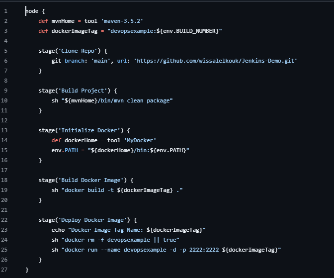

### Dockerfile

```dockerfile
FROM eclipse-temurin:17-jdk
VOLUME /tmp
COPY target/devOpsDemo-0.0.1-SNAPSHOT.jar /app.jar
CMD ["java", "-jar", "/app.jar"]
EXPOSE 2222
```

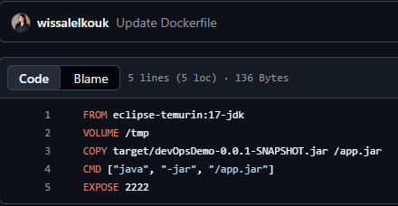

---

## 5. Exécution du pipeline

### Stage View

Les 5 étapes (Clone Repo, Build Project, Initialize Docker, Build Docker Image, Deploy Docker Image) du build #3 passent au vert.

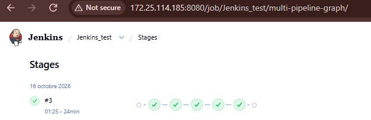

### Sortie de la console

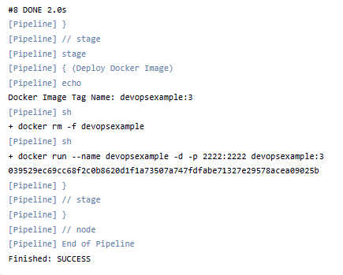

### Conteneur déployé

```bash
sudo -u jenkins docker ps
```

Le conteneur `devopsexample` (image `devopsexample:3`) tourne sur le port 2222.

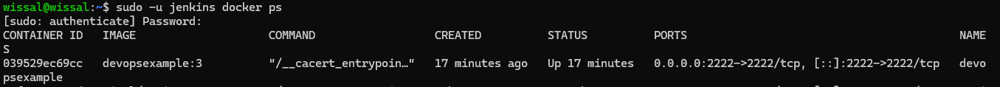

### Application accessible

L'application est accessible sur `http://172.25.114.185:2222`.

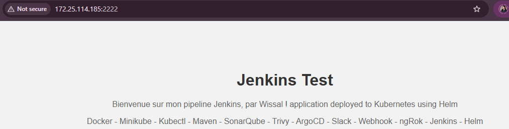

---

## 6. Problèmes rencontrés et solutions

| Problème | Cause | Solution |
|---|---|---|
| Plugins Kubernetes CLI / Credentials désactivés | Dépendance `kubernetes-client-api` manquante (installation interrompue par un redémarrage) | Réinstallation de *Kubernetes Client API* puis redémarrage. Ces plugins ne sont pas utilisés dans ce TP. |
| Plugin Docker en échec à l'installation | Jackson 2 API, commons-lang3 et bouncycastle devaient être mis à jour et Jenkins redémarré | Redémarrage de Jenkins puis réinstallation du plugin Docker |
| `JAVA_HOME` refusé (« ne semble pas être un répertoire contenant un JDK ») | Seul le JRE (`openjdk-21-jre`) était installé, sans `javac` | `sudo apt install openjdk-21-jdk` |
| Erreurs dans le Jenkinsfile du sujet | Guillemets typographiques, guillemet fermant manquant, `mvn` sans chemin | Correction du Jenkinsfile (guillemets droits, `${mvnHome}/bin/mvn`) |
| `docker run` : nom de conteneur déjà utilisé au 2ᵉ build | Ancien conteneur `devopsexample` encore présent | Ajout de `docker rm -f devopsexample \|\| true` avant `docker run` |
| `COPY` incorrect dans le Dockerfile | Le jar était copié vers `/app` mais exécuté depuis `/app.jar` | Correction en `COPY ... /app.jar` |
| `openjdk:17-jdk-slim: not found` au build Docker | L'image `openjdk` n'est plus disponible sur Docker Hub | Remplacement par `eclipse-temurin:17-jdk` |
| Build Docker très long (~24 min) au premier lancement | Téléchargement de l'image `eclipse-temurin:17-jdk` avec une connexion lente | Attendre la fin : l'image est ensuite en cache et les builds suivants sont rapides |


---

## 7. Conclusion

Ce TP a permis de mettre en place un pipeline CI/CD complet avec Jenkins : à chaque build, le code est récupéré depuis GitHub, compilé avec Maven, empaqueté dans une image Docker puis déployé automatiquement dans un conteneur. Il a aussi montré l'importance de vérifier les dépendances des plugins, les versions des outils et la disponibilité des images Docker.
